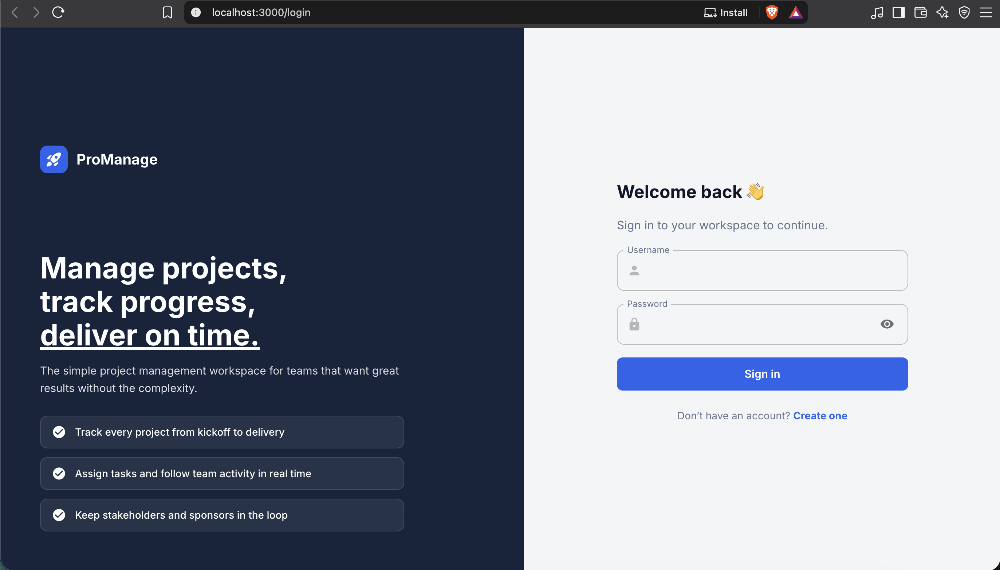
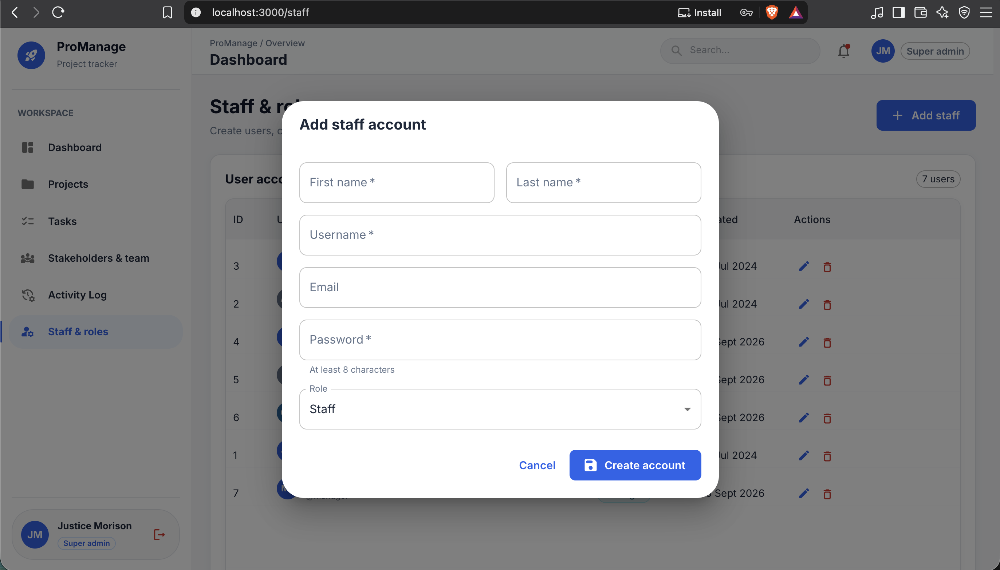
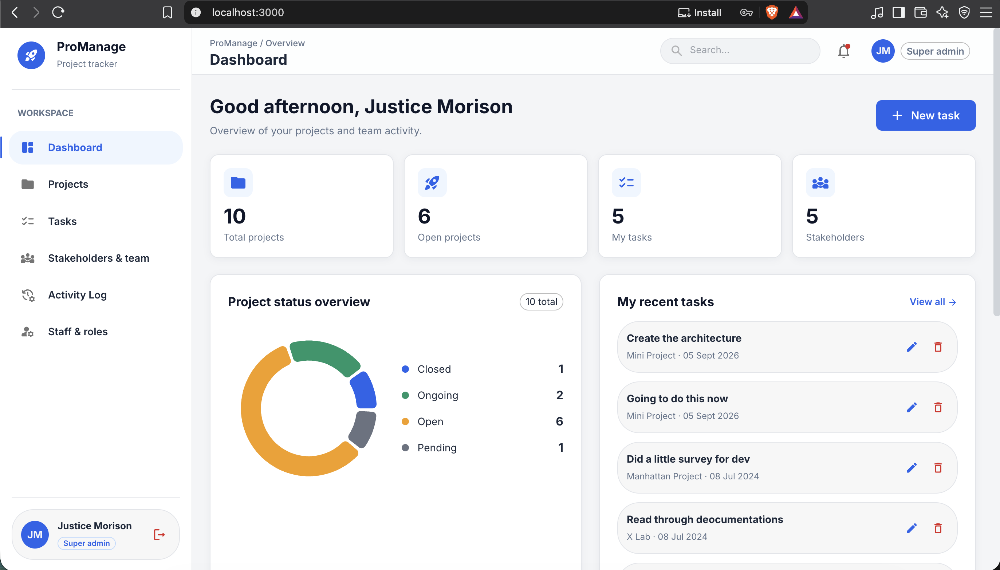

<div align="center">

# 🚀 ProManage

**A web-based project and team management system for small teams.**

Plan projects, assign staff with responsibilities and KPIs, log day-to-day task activity, keep stakeholders in the loop, and see where every project stands — all from one role-aware workspace.

[](https://www.djangoproject.com/)
[](https://www.django-rest-framework.org/)
[](https://react.dev/)
[](https://mui.com/)
[](https://www.sqlite.org/)

</div>

---

## Table of Contents

- [Overview](#overview)
- [Why ProManage](#why-promanage)
- [Features](#features)
- [Screenshots](#screenshots)
- [Tech Stack](#tech-stack)
- [Architecture](#architecture)
- [Repository Structure](#repository-structure)
- [Getting Started](#getting-started)
  - [Prerequisites](#prerequisites)
  - [1. Backend Setup](#1-backend-setup)
  - [2. Frontend Setup](#2-frontend-setup)
  - [3. First Login](#3-first-login)
- [Roles & Permissions](#roles--permissions)
- [API Reference](#api-reference)
- [Data Model](#data-model)
- [How Authentication Works](#how-authentication-works)
- [Configuration](#configuration)
- [Usage Walkthrough](#usage-walkthrough)
- [Testing](#testing)
- [Known Limitations & Roadmap](#known-limitations--roadmap)
- [Troubleshooting](#troubleshooting)
- [Credits](#credits)
- [License](#license)

---

## Overview

**ProManage** is a two-part web application built for small teams that need to manage projects without the overhead of a large platform. The frontend is a React single-page application; the backend is a Django REST API secured with JSON Web Tokens (JWT).

The system is built around one idea: **planning and evidence should live side by side**. A project has an owner, a status, dates and progress. Its staff are assigned with a written responsibility and a KPI or deliverable. The work they actually log — tasks, notes, challenges — is shown next to those commitments on the project detail page. Stakeholders are recorded separately as the external people who care about the outcome.

Visibility is **scoped on the server**, not hidden in the browser. Staff, Managers and Super Admins each receive only the projects and tasks they are allowed to see, and the ownership rules are enforced by the API as well as reflected in the interface.

> **Project type:** MCA Mini Project — Gujarat Technological University (GTU), L.D. Engineering College, Ahmedabad.

---

## Why ProManage

| Principle | How it is implemented |
|---|---|
| **Server-side scoping** | `visible_projects()` and `visible_tasks()` filter every list, detail and dashboard query by the signed-in user's role. Changing a URL or query parameter cannot expose another team's data. |
| **Ownership close to the object** | `OwnerModifyMixin` and object-level checks in the viewsets decide who may update or delete a project, task or stakeholder. Hiding a button is a convenience, not the security boundary. |
| **Commitments next to evidence** | A staff assignment stores a responsibility and a KPI. The project detail page shows each member's logged tasks beside their KPI, with a task count computed from real records. |
| **Roles that change the UI** | The sidebar, action buttons and admin screens respond to `is_staff` and `is_superuser` from `/api/me/`, so each role sees a workspace that matches its permissions. |
| **Small, understandable stack** | Django + DRF + SimpleJWT on the server, React + MUI + Axios on the client, SQLite for development. No build pipeline beyond Create React App. |


---

## Features

### 🔐 Authentication & roles
- Username/password sign-in backed by SimpleJWT (access + refresh tokens).
- Self-registration at `/register` creates a standard **Staff** account; elevated roles are created by a Super Admin.
- Automatic, single-flight token refresh in the Axios client, with retry of queued requests and sign-out if refresh fails.
- Protected routes redirect unauthenticated visitors to `/login`.
- Three roles — **Staff**, **Manager** and **Super Admin** — derived from Django's `is_staff` and `is_superuser` flags.

### 📊 Dashboard
- Personalised greeting and role-scoped summary tiles: total projects, open projects, my tasks, stakeholders.
- Project status donut chart (Open, Ongoing, Pending, Closed) with counts.
- "My recent tasks" list with inline edit and delete actions.
- Recent project cards with status chip, description, progress bar and date range.
- "New task" dialog available from the dashboard for every role.

### 📁 Project management
- Responsive card grid of every project the signed-in user can see.
- Managers and Super Admins can create, edit and delete projects; project owners can edit their own.
- Status (`Open`, `Ongoing`, `Pending`, `Closed`) and manager-controlled progress (0–100%, slider in 5% steps).
- Date range, creator name, description and a progress bar on every card.
- Role-aware empty states that explain what to do next.

### ✅ Task activity log
- Log a task against a project with task title, notes and challenges.
- Full-width, filterable and sortable data grid with avatar-based staff column, pagination and **CSV export**.
- Edit your own task entries at `/updatetask/:id/`; managers can edit tasks in projects they lead.
- Delete tasks with confirmation.
- Server-side scoping: Staff see their own entries, Managers see tasks on projects they created, Super Admins see everything.

### 🤝 Stakeholders
- Record external stakeholders per project: name, position, contact email and activity.
- Project picker persists the selection in the query string (`/stakeholders?project=13`), so the view survives a refresh and can be linked to directly.
- Tabs separate **Stakeholders** from **Assigned staff (KPI)**.
- Email addresses are rendered as `mailto:` links; grids support quick filter and CSV export.
- Managed by Managers and Super Admins; Staff see a clear permission message instead of the tables.

### 👥 Team assignments & KPIs
- Assign a registered user to a project with a **responsibility** and a **KPI / deliverable**.
- A user cannot be assigned to the same project twice (enforced by a unique constraint and a friendly serializer error).
- Task counts per member are computed from real task records, not maintained by hand.
- Project detail page shows each member's KPI beside their recent logged activity, plus an "All members active" / "X of Y members logged tasks" summary.
- Removing an assignment deletes the link only — not the user, their tasks or the project.

### 🛠️ Administration
- **Staff & roles** page (Super Admin only): create users, change roles, reset passwords, delete accounts.
- Roles are derived from flags: Staff = both flags false, Manager = `is_staff = True`, Super Admin = both flags true.
- Safeguards: you cannot delete your own account, and only a Super Admin may create, update or delete accounts.
- **Activity log** page (Super Admin only) reads Django's admin `LogEntry` history with action chips and CSV export.
- Django admin available at `/admin/` for direct data administration.

### 🎨 Interface
- Material UI 5 with a custom lightweight theme, responsive layout, desktop sidebar and mobile drawer.
- Loading, empty, error and permission states designed for every screen.
- Data grids include column visibility, density, quick filter and CSV export.
- Profile page with account details, role, workspace counts and sign-out.

---

## Screenshots

### Sign in
The entry point for every role, with a two-panel brand layout, password visibility toggle and inline error handling.



### Create a user account
Super Admins create Staff, Manager or Super Admin accounts from the **Staff & roles** page. New users can also self-register at `/register`, which always creates a Staff account.



### Dashboard
Role-scoped statistics, a project status donut chart, recent tasks and recent project cards.



### Project list
A responsive card grid showing status, owner, description, progress and date range, with manager-only edit and delete controls.


### Project detail — overview and team contribution
The project hero with overall progress, summary tiles, and each assigned member's responsibility, KPI and logged activity.


### Project detail — task and stakeholder tables
Task activity and stakeholder records for the project, both with quick filter and CSV export.


### Task activities
The workspace-wide, permission-scoped task log with filtering, pagination and export.


### Update task
A focused edit form that keeps the project read-only and lets the author revise the task, notes and challenges.


### Stakeholders & team
Choose a project, then manage external stakeholders or assign staff with a responsibility and a KPI.


### Staff & roles
Super Admin user administration: role chips, account creation, editing and deletion.


> **Note:** Screenshot filenames contain spaces, so the image links above use `%20` URL encoding. Keep that encoding if you rename or move the files.


---

## Tech Stack

### Backend

| Layer | Technology |
|---|---|
| Language | Python 3.12 (tested with 3.12.12) |
| Web framework | Django 6.1.1 |
| API layer | Django REST Framework 3.18.0 |
| Authentication | `djangorestframework-simplejwt` 5.5.1 (JWT access + refresh tokens) |
| CORS | `django-cors-headers` |
| Configuration | `python-dotenv` |
| Database | SQLite for development; `psycopg2-binary` is included for PostgreSQL |
| Admin | Django admin (`/admin/`) |

### Frontend

| Layer | Technology |
|---|---|
| Language | JavaScript (ES2020+) / JSX |
| UI library | React 18.3.1 |
| Build tool | Create React App (`react-scripts` 5.0.1) |
| Routing | React Router DOM 6.24 |
| Component library | Material UI 5.15 (`@mui/material`, `@mui/icons-material`) |
| Data grid | MUI X Data Grid 7.8 |
| HTTP client | Axios 1.7 |
| Charts | Recharts 3.10 |
| CSV export | `react-csv` |
| Animation | `framer-motion` |
| Token decoding | `jwt-decode` |
| Testing | React Testing Library / Jest (via CRA) |

---

## Architecture

```
┌───────────────────────────────────┐        JSON over HTTP        ┌──────────────────────────────────┐
│      React SPA — localhost:3000   │  ────────────────────────▶   │    Django REST API — :8000       │
│                                   │                              │                                  │
│  React Router  →  page components │  ◀────────────────────────   │  DRF viewsets & APIViews         │
│  MUI theme     →  layout & grids  │      JWT Bearer token        │  SimpleJWT authentication        │
│  Axios         →  API client      │                              │  Role-scoped querysets           │
└───────────────────────────────────┘                              └────────────────┬─────────────────┘
                                                                                    │ Django ORM
                                                                                    ▼
                                                                       ┌──────────────────────────┐
                                                                       │  SQLite (development)    │
                                                                       │  backend/.../db.sqlite3  │
                                                                       └──────────────────────────┘
```

**Request lifecycle**

1. The user signs in at `/login`; the SPA posts credentials to `POST /api/token/`.
2. The API returns an `access` token (30 minutes) and a `refresh` token (1 day). Both are stored in `localStorage`.
3. The SPA loads the profile from `GET /api/me/`, which supplies the user's name, role and flags.
4. Every Axios request automatically carries `Authorization: Bearer <access>`.
5. If a request returns `401`, the response interceptor refreshes the access token once, retries queued requests, and signs the user out if the refresh itself fails.
6. On the server, DRF authenticates the token, and each view scopes its queryset through `visible_projects()` / `visible_tasks()` before serialising a response.

**Why a separate API?** The React client never touches the database. All permission rules, ownership checks and data scoping live in one place on the server, so the rules hold whether the data is requested by the UI, `curl`, or any future mobile client.

---

## Repository Structure

```text
ProManage/
├── backend/
│   ├── requirements.txt              # Python dependencies
│   ├── venv/                         # local virtual environment (git-ignored)
│   └── probackend/
│       ├── manage.py
│       ├── db.sqlite3                # development database (git-ignored)
│       ├── probackend/
│       │   ├── settings.py           # DRF, JWT, CORS and app configuration
│       │   ├── urls.py               # auth, dashboard and custom API routes
│       │   └── api/
│       │       └── urls.py           # aggregates the DRF router registries
│       └── projects/
│           ├── models.py             # Project, Stakeholders, ProjectStaff, Taskactivities
│           ├── migrations/
│           └── api/
│               ├── serializers.py    # request/response shapes and validation
│               ├── url.py            # router registrations
│               └── views.py          # scoping helpers, viewsets and permission rules
│
├── Frontend/
│   ├── package.json                  # dependencies and the dev proxy target
│   ├── .env                          # local dev environment variables
│   ├── public/
│   └── src/
│       ├── index.js                  # React entry point
│       ├── App.js                    # theme + user context + router provider
│       ├── Router.jsx                # all client routes and the route guard
│       ├── api.js                    # Axios instance, token attach + refresh
│       ├── theme.js                  # MUI theme
│       ├── utils.js                  # dates, initials, roles, progress helpers
│       ├── context/
│       │   └── UserContext.jsx       # current user, loading state, logout
│       └── components/
│           ├── auth/                 # Login, Register, AuthLayout
│           ├── layout/               # Layout, Sidebar, Topbar
│           ├── Dashboard/            # Dashboard, CreateTaskDialog
│           ├── common/               # dialogs, loading, empty states
│           ├── data/                 # TasksTable and shared grids
│           ├── Projects.jsx
│           ├── ProjectDetails.jsx
│           ├── Tasks.jsx
│           ├── Update.jsx
│           ├── Stakeholders.jsx
│           ├── StaffManagement.jsx
│           ├── Profile.jsx
│           ├── LogCard.jsx
│           └── ProtectedRoute.jsx
│
├── screenshots/                      # application screenshots used in this README
├── Report.md                         # full project report (design, review, enhancements)
└── Readme.md                         # this file
```


---

## Getting Started

### Prerequisites

| Requirement | Version / Notes |
|---|---|
| **Python** | 3.12 or newer (Django 6.1 requires Python 3.12+) |
| **pip** | Bundled with Python |
| **Node.js** | 18 LTS or newer recommended (Create React App 5) |
| **npm** | 9+ |
| **Git** | To clone the repository |
| **Browser** | Any modern browser (Chrome, Edge, Firefox, Safari) |

The project runs as two development servers:

- Django API → `http://127.0.0.1:8000`
- React app → `http://localhost:3000`

---

### 1. Backend Setup

From the project root:

```bash
cd backend

# Create and activate a virtual environment
python3 -m venv venv
source venv/bin/activate

# Install dependencies
pip install -r requirements.txt

# Apply the existing migrations
cd probackend
python manage.py migrate

# Create the first administrator (Super Admin)
python manage.py createsuperuser

# Start the API
python manage.py runserver
```

**Windows (PowerShell):**

```powershell
cd backend
py -m venv venv
venv\Scripts\Activate.ps1
pip install -r requirements.txt
cd probackend
python manage.py migrate
python manage.py createsuperuser
python manage.py runserver
```

Once running:

| URL | Purpose |
|---|---|
| `http://127.0.0.1:8000/api/` | REST API root (DRF router index) |
| `http://127.0.0.1:8000/admin/` | Django admin |
| `http://127.0.0.1:8000/api/token/` | Obtain a JWT token pair |

> **Notes**
> - The repository's local `backend/venv` and `backend/probackend/db.sqlite3` are excluded by `.gitignore`; a fresh clone creates its own database when `migrate` runs.
> - Migrations `0001`–`0006` are committed, including `0006_project_progress_projectstaff.py`.
> - If you prefer PostgreSQL, set up the database and update `DATABASES` in `probackend/settings.py`; `psycopg2-binary` is already listed in `requirements.txt`.

---

### 2. Frontend Setup

In a **second terminal**:

```bash
cd Frontend
npm install
npm start
```

The app opens at **`http://localhost:3000`**.

#### API URL configuration

Axios reads its base URL from `REACT_APP_API_URL`:

```js
// Frontend/src/api.js
const BASE_URL = process.env.REACT_APP_API_URL || '';
```

- **If `REACT_APP_API_URL` is empty** (the default), requests are relative and Create React App's development proxy forwards them to `http://127.0.0.1:8000` (configured under `"proxy"` in `Frontend/package.json`). This is the simplest local setup.
- **To point the SPA at another API host**, create `Frontend/.env.local` (do not overwrite the existing `.env`, which holds `WDS_SOCKET_PORT=443` for VS Code port forwarding):

  ```bash
  echo "REACT_APP_API_URL=http://127.0.0.1:8000" > Frontend/.env.local
  ```

  CRA loads `.env.local` automatically and it is excluded from git by the repository's `.env.*` rule.

- **For a production build**, set the deployed API origin before building:

  ```bash
  REACT_APP_API_URL=https://api.example.com npm run build
  ```

#### CORS

The backend currently allows cross-origin requests from `http://localhost:3000` and `http://localhost:8080` and also enables `CORS_ALLOW_ALL_ORIGINS`. If you run the frontend on a different port, either add the origin to `CORS_ALLOWED_ORIGINS` in `backend/probackend/probackend/settings.py` or rely on the permissive development setting. See [Known Limitations](#known-limitations--roadmap) before deploying.

---

### 3. First Login

1. Open `http://localhost:3000/login` and sign in with the superuser you created.
2. Go to **Staff & roles** in the sidebar and create Manager and Staff accounts, **or** open `http://localhost:3000/register` to self-register a Staff account.
3. Sign out and sign in as a Manager to create the first project.
4. As a Manager or Super Admin, open **Stakeholders & team** to assign staff with a responsibility and KPI.
5. Staff can then sign in, open their assigned projects, and log task activity.

> There is no seed-data command yet. Create the first project through the UI (Managers/Super Admins only). Staff accounts cannot create projects by design.


---

## Roles & Permissions

ProManage uses Django's built-in user flags. No custom user model is required.

| Role | Flags | Typical use |
|---|---|---|
| **Staff** | `is_staff = False`, `is_superuser = False` | Team member who logs work on assigned projects |
| **Manager** | `is_staff = True`, `is_superuser = False` | Project lead who creates projects and manages their team |
| **Super Admin** | `is_staff = True`, `is_superuser = True` | Workspace administrator with full access |

### Permission matrix

| Capability | Staff | Manager | Super Admin |
|---|:---:|:---:|:---:|
| Sign in / view own profile | ✅ | ✅ | ✅ |
| View visible projects | ✅ assigned | ✅ created + assigned | ✅ all |
| Create / delete projects | ❌ | ✅ | ✅ |
| Edit project & progress | ❌ (unless owner) | ✅ | ✅ |
| View task log | ✅ own tasks | ✅ tasks on projects they created | ✅ all |
| Create tasks | ✅ | ✅ | ✅ |
| Edit / delete tasks | ✅ own | ✅ own + tasks in their projects | ✅ all |
| View stakeholders | ✅ (read; page hidden) | ✅ | ✅ |
| Add / edit / delete stakeholders | ❌ | ✅ | ✅ |
| Assign staff with KPI | ❌ | ✅ (own projects) | ✅ |
| View user directory | ❌ | ✅ | ✅ |
| Create / edit / delete users | ❌ | ❌ | ✅ |
| View activity log | ❌ | ❌ | ✅ |

**How the backend scopes data**

```python
def visible_projects(user):
    if user.is_superuser:
        return Project.objects.all()
    created = Project.objects.filter(created_by=user)
    assigned = Project.objects.filter(staff__user=user)
    return (created | assigned).distinct()

def visible_tasks(user):
    if user.is_superuser:
        return Taskactivities.objects.all()
    if user.is_staff:
        return Taskactivities.objects.filter(project__created_by=user)
    return Taskactivities.objects.filter(user=user)
```

> **Important nuance:** a Manager's task list is scoped to projects **they created**, not to every project they are merely assigned to. The UI may show edit controls for a manager on a project they are assigned to, but the API will refuse the write. See the project report for the full permission review.

**Role checks beyond the queryset**

- `OwnerModifyMixin` allows any Manager, but restricts non-managers to records they created.
- Project creation (`POST /api/projects/` or `/api/createproject/`) is rejected for Staff with `403`.
- Stakeholder creation requires `is_staff` or `is_superuser`.
- Staff assignment creation requires a Manager or the project owner.
- User creation, update and deletion require `is_superuser`; deleting your own account is refused.
- `/api/log/` uses the `IsSuperUser` permission class.
- The React sidebar hides screens the current role cannot use, but the API is the security boundary.


---

## API Reference

**Base URL (development):** `http://127.0.0.1:8000`

All endpoints are prefixed with `/api/` and expect/return JSON. Authenticated requests must include:

```http
Authorization: Bearer <access_token>
```

Trailing slashes are required (Django `APPEND_SLASH` / DRF router convention).

### Authentication & session

| Method | Endpoint | Access | Description |
|---|---|---|---|
| `POST` | `/api/token/` | Public | Obtain an `access` + `refresh` token pair |
| `POST` | `/api/token/refresh/` | Public (valid refresh) | Exchange a refresh token for a new access token |
| `POST` | `/api/user/register/` | Public | Self-register a **Staff** account |
| `GET` | `/api/me/` | Authenticated | Current user's profile, role and flags |
| `GET` | `/api/dashboard/` | Authenticated | Role-scoped dashboard statistics |

### Projects

| Method | Endpoint | Access | Description |
|---|---|---|---|
| `GET` | `/api/projects/` | Authenticated | List projects visible to the user |
| `POST` | `/api/projects/` | Manager / Super Admin | Create a project (owner set from the token) |
| `GET` | `/api/projects/{id}/` | Authenticated | Retrieve one visible project |
| `PUT` / `PATCH` | `/api/projects/{id}/` | Owner / Manager | Update project, status and progress |
| `DELETE` | `/api/projects/{id}/` | Owner / Manager | Delete a project (cascades to tasks, stakeholders and assignments) |
| `GET` / `POST` | `/api/createproject/` | Authenticated / Manager+ | Alternate list/create endpoint used by the UI |
| `GET` | `/api/sproject/{id}/` | Authenticated | Specific project (scoped list) |

### Tasks

| Method | Endpoint | Access | Description |
|---|---|---|---|
| `GET` | `/api/tasks/` | Authenticated | Scoped task list (see `visible_tasks`) |
| `GET` | `/api/tasks/{id}/` | Authenticated | Retrieve a visible task |
| `PUT` / `PATCH` | `/api/tasks/{id}/` | Task author / Manager | Update a task |
| `DELETE` | `/api/tasks/{id}/` | Task author / Manager | Delete a task |
| `GET` / `POST` | `/api/createtask/` | Authenticated | List your own tasks / log a new task |
| `GET` / `PUT` / `PATCH` | `/api/updatetask/{id}/` | Task author / Manager | Load and update a task for the edit form |
| `DELETE` | `/api/taskdelete/{id}/` | Task author / Manager | Delete a task (used by the dashboard) |
| `GET` | `/api/stasks/{project_id}/` | Authenticated | All tasks for one visible project |

> On creation the server sets `user` from the authenticated request; the `user` field is read-only, so authorship cannot be forged in the request body.

### Stakeholders

| Method | Endpoint | Access | Description |
|---|---|---|---|
| `GET` | `/api/stakeholders/` | Authenticated | Stakeholders on visible projects |
| `POST` | `/api/stakeholders/` | Manager / Super Admin | Add a stakeholder |
| `GET` | `/api/stakeholders/{id}/` | Authenticated | Retrieve a stakeholder |
| `PUT` / `PATCH` | `/api/stakeholders/{id}/` | Owner / Manager | Update a stakeholder |
| `DELETE` | `/api/stakeholders/{id}/` | Owner / Manager | Delete a stakeholder |
| `GET` / `POST` | `/api/createstake/` | Authenticated / Manager+ | Alternate list/create endpoint |
| `GET` | `/api/sstake/{project_id}/` | Authenticated | Stakeholders for one visible project |

### Team assignments (ProjectStaff)

| Method | Endpoint | Access | Description |
|---|---|---|---|
| `GET` | `/api/projectstaff/` | Authenticated | Assignments on visible projects |
| `GET` | `/api/projectstaff/?project={id}` | Authenticated | Assignments for one project |
| `POST` | `/api/projectstaff/` | Manager / Project owner | Assign a user with responsibility + KPI |
| `GET` | `/api/projectstaff/{id}/` | Authenticated | Retrieve an assignment |
| `PUT` / `PATCH` / `DELETE` | `/api/projectstaff/{id}/` | Manager / Project owner | Update or remove an assignment |

### Users & activity log

| Method | Endpoint | Access | Description |
|---|---|---|---|
| `GET` | `/api/users/` | Manager / Super Admin | User directory (Staff receive an empty list) |
| `POST` | `/api/users/` | Super Admin | Create a user and assign a role |
| `GET` | `/api/users/{id}/` | Manager / Super Admin | Retrieve a user |
| `PUT` / `PATCH` / `DELETE` | `/api/users/{id}/` | Super Admin | Update, change role/password or delete a user |
| `GET` | `/api/log/` | Super Admin | Django admin change history (`LogEntry`) |

### Example requests

**Obtain a token pair**

```bash
curl -X POST http://127.0.0.1:8000/api/token/ \
  -H "Content-Type: application/json" \
  -d '{"username": "your-username", "password": "your-password"}'
```

```json
{
  "access": "eyJhbGciOiJIUzI1NiIsInR5cCI6IkpXVCJ9...",
  "refresh": "eyJhbGciOiJIUzI1NiIsInR5cCI6IkpXVCJ9..."
}
```

**List visible projects**

```bash
curl -H "Authorization: Bearer <ACCESS_TOKEN>" \
  http://127.0.0.1:8000/api/projects/
```

**Log a task**

```bash
curl -X POST http://127.0.0.1:8000/api/createtask/ \
  -H "Authorization: Bearer <ACCESS_TOKEN>" \
  -H "Content-Type: application/json" \
  -d '{
    "project": 13,
    "task": "Inspect 8 schools",
    "notes": "Week 1 field visit",
    "challenges": "Transport availability"
  }'
```

**Refresh an expired access token**

```bash
curl -X POST http://127.0.0.1:8000/api/token/refresh/ \
  -H "Content-Type: application/json" \
  -d '{"refresh": "<REFRESH_TOKEN>"}'
```

> **Pagination:** list endpoints currently return bare JSON arrays (no pagination envelope). Filtering and paging for the tables happen in the browser. This is listed as a deployment improvement in the roadmap.


---

## Data Model

```text
┌────────────────────┐
│   Django User      │
│  (auth_user)       │
└─────────┬──────────┘
          │ 1
          │
          │ *
┌─────────▼──────────┐          ┌──────────────────────┐
│      Project       │ 1      * │    Stakeholders      │
│  name, details,    ├──────────│  name, position,     │
│  startdate,        │          │  email, activity     │
│  enddate, status,  │          └──────────────────────┘
│  progress,         │
│  created_by        │ 1      * ┌──────────────────────┐
│                    ├──────────│    ProjectStaff      │
│                    │          │  responsibility, KPI │
│                    │          │  unique(project,user)│
│                    │          └──────────┬───────────┘
│                    │ 1      *            │ * → 1 User
│                    ├──────────┐          │
│                    │          ▼          │
│                    │  ┌──────────────────┴─────┐
│                    │  │    Taskactivities      │
│                    │  │  task, notes,          │
│                    │  │  challenges,           │
│                    │  │  user (author)         │
│                    │  └────────────────────────┘
└────────────────────┘
```

| Model | Key fields | Relationships |
|---|---|---|
| **Project** | `name`, `details`, `startdate`, `enddate`, `status`, `progress` (0–100), `created_at` | `created_by → User` |
| **Stakeholders** | `name`, `email`, `position`, `activity`, `created_at` | `project → Project` (CASCADE), `created_by → User` |
| **ProjectStaff** | `responsibility`, `kpi`, `created_at` | `project → Project` (CASCADE), `user → User` (CASCADE), unique `(project, user)` |
| **Taskactivities** | `task`, `notes`, `challenges`, `created_at` | `project → Project` (CASCADE), `user → User` (author) |

**Notes on the model**

- `Project.progress` is a manager-controlled percentage. If a project has no stored progress, the frontend falls back to `computeProgress()`, which estimates the elapsed share of the start–end date range.
- `status` accepts `Open`, `Ongoing`, `Pending` and `Closed`. The four values are enforced by the project form, not by a database enum (a `TextChoices` field is proposed in the report).
- Deleting a project cascades to its tasks, stakeholders and staff assignments. Deleting a user may be blocked by the database because several foreign keys use `DO NOTHING` (see the roadmap).
- `ProjectStaff` is a join record with payload: it records not only *who* is on the project but *what they are responsible for* and *what they must deliver*.

---

## How Authentication Works

```
Login form
   │  POST /api/token/  { username, password }
   ▼
SimpleJWT
   │  { access, refresh }
   ▼
localStorage: "access", "refresh"
   │
   ├─ Axios request interceptor  →  Authorization: Bearer <access>
   │
   ├─ GET /api/me/  →  { id, name, email, is_staff, is_superuser, role, date_joined }
   │
   └─ ProtectRoute / UserContext  →  sidebar, buttons and admin screens
```

**Key behaviours**

- **Login waits for the profile.** `Login.jsx` stores the tokens and calls `refetchUser()` before navigating, so managers and super admins do not briefly see the staff version of the sidebar.
- **One token refresh at a time.** If several requests fail with `401`, the first starts a refresh and the others queue. When the new access token arrives, queued requests retry with it.
- **Refresh failure logs out.** If refresh fails, both tokens are removed, the user context is cleared and the browser is sent to `/login`.
- **Route protection is client-side.** `ProtectedRoute` checks for a token and redirects to `/login`; server-side enforcement is handled by DRF's `IsAuthenticated` default and the object-level permission checks.
- **Tokens are stored in `localStorage`.** This is convenient for development but readable by any script on the origin; the report recommends moving the refresh token to an httpOnly cookie before production use.

---

## Configuration

### Backend — `backend/probackend/probackend/settings.py`

| Setting | Current value | Notes |
|---|---|---|
| `SECRET_KEY` | Hard-coded development key | Must move to an environment variable before deployment |
| `DEBUG` | `True` | Must be `False` in production |
| `ALLOWED_HOSTS` | `['*']` | Restrict to real hosts in production |
| `CORS_ALLOWED_ORIGINS` | `http://localhost:8080`, `http://localhost:3000` | Add your frontend origin if it changes |
| `CORS_ALLOW_ALL_ORIGINS` | `True` | Development convenience; remove for deployment |
| `DEFAULT_AUTHENTICATION_CLASSES` | `JWTAuthentication` | Token authentication on every endpoint |
| `DEFAULT_PERMISSION_CLASSES` | `IsAuthenticated` | Authentication required unless a view overrides it |
| `ACCESS_TOKEN_LIFETIME` | 30 minutes | Configurable in `SIMPLE_JWT` |
| `REFRESH_TOKEN_LIFETIME` | 1 day | No rotation or blacklist enabled yet |
| `DATABASES` | SQLite (`db.sqlite3`) | PostgreSQL is supported through the ORM |

The settings module calls `load_dotenv()`, so a `.env` file can be placed alongside `manage.py`. Note that the values above are currently written directly in `settings.py`; they are not yet read from environment variables.

### Frontend — `Frontend/.env`

| Variable | Current value | Purpose |
|---|---|---|
| `WDS_SOCKET_PORT` | `443` | Makes the CRA dev server work behind a VS Code forwarded HTTPS port |
| `REACT_APP_API_URL` | *(not set)* | Optional API origin; when empty, the dev proxy in `package.json` is used |

For local development with the default backend port, no change is required. For any other API host, set `REACT_APP_API_URL` in `Frontend/.env.local` and restart `npm start` (CRA only reads environment files at startup).

